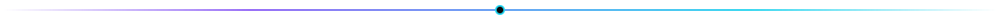
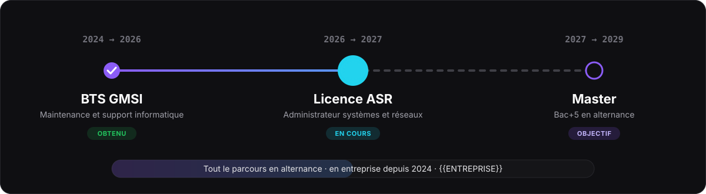

  

  
  
  

   whoami : Charly, alternant administrateur systèmes et réseaux · BTS GMSI, Licence ASR, Master · Cybersécurité, cloud Microsoft, infrastructure, automatisation, IA · Projets : Nexus, Pulse, Station Blanche, Homelab" />

## 🎓 Parcours

  

## 💼 Expérience

### Alternant administrateur systèmes et réseaux
📅 Septembre 2024 → aujourd'hui · équipe infrastructure (1 manager, 2 ingénieurs, 1 technicien)

- 🏗️ **Infrastructure** — participation au déploiement d'une infrastructure **Hyper-V** sur deux sites (baies **SAN**, sauvegardes **Veeam**)
- ☁️ **Microsoft 365** — administration de tenants clients (**Entra ID**, **Exchange Online**) et intégration du filtrage de messagerie **Hornetsecurity 365 Total Protection**
- ⚙️ **Automatisation** — circuit d'approbation des demandes d'avoir avec **Power Automate** et **Microsoft Forms** (validation par la direction)
- 🛡️ **Sécurité** — conception d'une **station blanche** de décontamination USB (Ubuntu, double moteur antivirus, rapports PDF)
- 📚 **Documentation** — rédaction de procédures techniques pour le wiki de l'équipe (**BookStack**)
- 🧰 **Support et maintenance** du parc (postes Windows, comptes, accès)

## 🧰 Compétences

  

<table align="center">
<tr>
<td valign="top" width="50%">

**🖥️ Systèmes et infrastructure**

</td>
<td valign="top" width="50%">

**☁️ Cloud et Microsoft 365**

</td>
</tr>
<tr>
<td valign="top">

**🌐 Réseaux et sécurité**

</td>
<td valign="top">

**⚙️ Automatisation, dev et IA**

</td>
</tr>
</table>

## 🚀 Projets

  
  

  
  

🔒 Nexus et Pulse sont développés dans des dépôts privés · Station Blanche est un projet d'entreprise

## 📈 Activité

  <picture>
    <source media="(prefers-color-scheme: dark)" srcset="https://raw.githubusercontent.com/El-Kamzy-FR/El-Kamzy-FR/output/github-snake-dark.svg" />
    <source media="(prefers-color-scheme: light)" srcset="https://raw.githubusercontent.com/El-Kamzy-FR/El-Kamzy-FR/output/github-snake.svg" />
    
  </picture>

  <b>Ouvert aux échanges</b> : infrastructure, Microsoft 365, cybersécurité, outils Windows. 
  🌐 <a href="https://el-kamzy-fr.github.io">el-kamzy-fr.github.io</a> — mon portfolio en 3D

Page générée en SVG fait maison · mise à jour automatique du serpent chaque nuit via GitHub Actions
